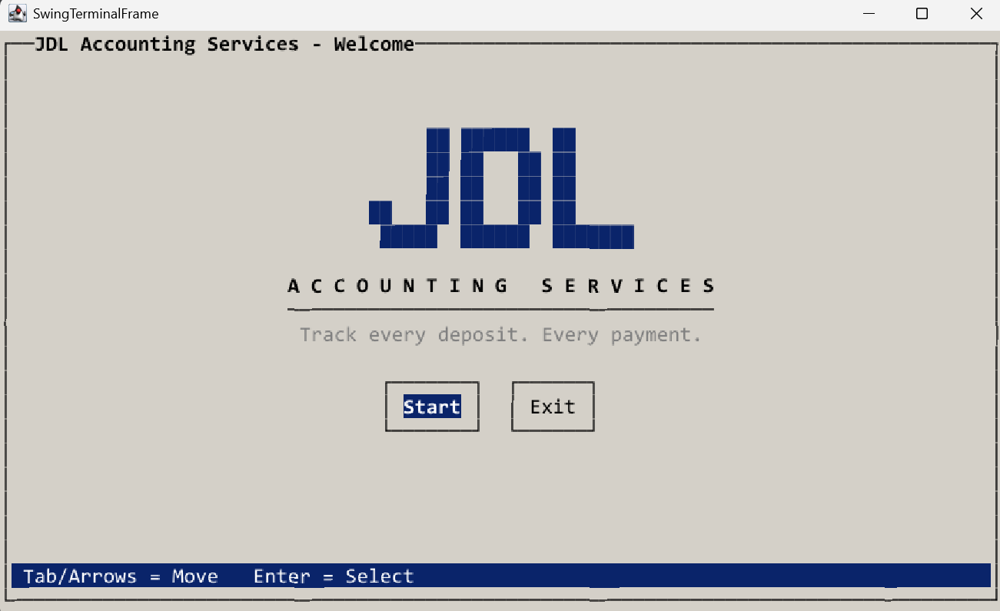

# 🏛️ JDL Accounting Services - Capstone 1

## Project Summary

**JDL Accounting Services** is a Java CLI application for tracking financial transactions. You can record `deposits` and `payments`, which are saved to a CSV file. You can view the `ledger` as all entries, deposits only or payments only.    

You can also run `reports` according to:
- `month-to-date`
- `previous month`
- `year-to-date`
- `previous year`
- `vendor search`

A `custom search` lets you filter by any combination of `date` range, `description`, `vendor` and `amount`.  

## Features

<p align="center">
    
    
    
</p>

## How to Run

**Requires:** Java 17+ and IntelliJ

1. Clone the repo:
    ```bash
    git clone https://github.com/josweon/capstone-1.git
    ```
2. Open the folder in IntelliJ.
3. Run `AccountingLedgerApp.java`.

## Project Structure

```
capstone-1/
├── pom.xml
├── README.md
└── src/main/
    ├── java/com/pluralsight/
    │   ├── AccountingLedgerApp.java   # menus, reports, file I/O
    │   └── Transaction.java           # transaction model
    └── resources/
        ├── transactions.csv           # ledger data
        └── test-transactions.csv      # sample data for TESTING
```

## Interesting Code
```java
    //From loadTransaction() in the Main Class
    //Lines 430-436
    String formatDateTime = String.format("%sT%s", tokens[0], tokens[1]); //<- Combines date/time to form a DateTime object
    LocalDateTime dateTime = LocalDateTime.parse(formatDateTime); //<- ISO 8601 format (yyyy-MM-dd'T'HH:mm:ss)
    String description = tokens[2];
    String vendor = tokens[3];
    double amount = Double.parseDouble(tokens[4]);

    ledger.add(new Transaction(dateTime, description, vendor, amount)); // <- takes one DateTime
    
```

## Future Improvements
1. **Lanterna TUI:** Add an interactive full-screen terminal interface.
<p align="center">
   
</p>

2. **Show running balance and totals:** Show the current balance plus total deposits and payments under each report.
3. **Display DateTime in a more user-friendly manner:** Currently displays as `2026-11-06` and changing to `Friday, Nov 6th` would be digested faster.
4. **Export reports:** Have the option to export reports to *.json* or *.csv* formats.
