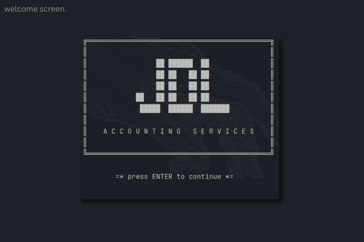
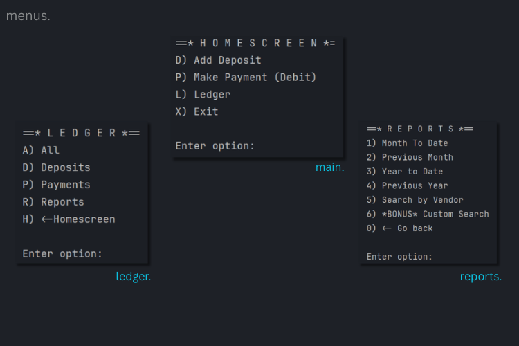
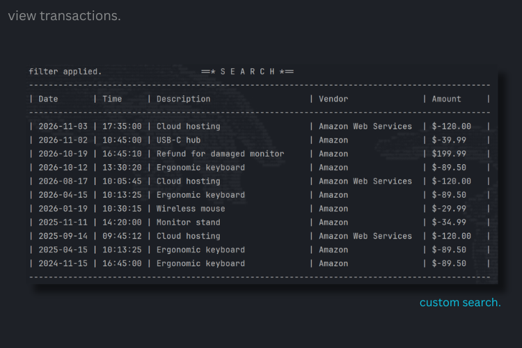

# 🏛️ JDL Accounting Services - Capstone 1

## Project Summary

**JDL Accounting Services** is a Java CLI application for tracking financial transactions. You can record `deposits` and `payments`, which are saved to a CSV file. You can view the `ledger` as all entries, deposits only or payments only.    

You can also run `reports` according to:
- `month-to-date`
- `previous month`
- `year-to-date`
- `previous year`
- `vendor search`

A `custom search` lets you filter by any combination of `date` range, `description`, `vendor` and `amount`.  

## Features






-[]How to run

## Project Structure

```
capstone-1/
├── pom.xml
├── README.md
└── src/main/
    ├── java/com/pluralsight/
    │   ├── AccountingLedgerApp.java   # menus, reports, file I/O
    │   └── Transaction.java           # transaction model
    └── resources/
        ├── transactions.csv           # ledger data
        └── test-transactions.csv      # sample data for TESTING
```

### Interesting Code
```java
    
    String formatDateTime = String.format("%sT%s", tokens[0], tokens[1]);
    LocalDateTime dateTime = LocalDateTime.parse(formatDateTime);
    String description = tokens[2];
    String vendor = tokens[3];
    double amount = Double.parseDouble(tokens[4]);

    ledger.add(new Transaction(dateTime, description, vendor, amount));
    
```

-[]future Improvements